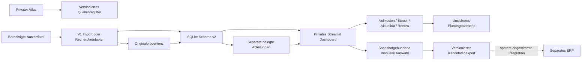

# Architekturstand 03

Register lädt keine Websites und gibt keine Kalkulationsdefaults. Import v1 bleibt stabil; ResearchBatch ergänzt Originalprovenienz ohne Originaldaten durch Schätzungen zu ersetzen. Historie speichert Beobachtungen, nicht Artikel-/Lagerstammdaten. Szenarien geben ihre Eingaben zurück; UI-Pläne derzeit nicht dauerhaft gespeichert.

`contracts.candidate_export(store, workspace)` liefert Schema1 mit `event_type=opportunity.selected`, `generated_at`, `selection_kind=manual_not_profit_verified` und `candidates`. Ein Kandidat enthält `offer_key`, `approved_snapshot_at`, `approval_status=manually_selected` und das unveränderte v1-Listing. `validate_candidate_export` prüft Struktur, IDs, Snapshotbindung und Dubletten. Der Export ist keine Rechnungs-/Bestands- oder Kaufanweisung. Kein Transport zum ERP.

Die vorgeschlagenen `/api/v1`-Routen aus [Architektur02](ARCHITECTURE.md) bleiben unimplementiert. Eine spätere API muss OIDC/Bearer prüfen, Workspace aus autorisierter Identität ableiten, Limits/Idempotenz/Fehlercodes erzwingen und Empfangsbestätigungen ohne doppelte Übernahme verarbeiten. Kein Tenant aus Clientparametern. Endgültige ERP-Felder und Berechtigungen erst nach Bekanntwerden des ERP-Vertrags abstimmen.

Python-Import und CLI lokal testbar; wiederholter Watch benötigt laufenden Server. Streamlit ist die mobile Bedienoberfläche, kein iOS-Hintergrundworker. Kein kostenpflichtiger Cloudanbieter erforderlich; kostenlose Einstiegsangebote garantieren weder 24/7 noch Persistenz. Keine Infrastruktur provisioniert.
