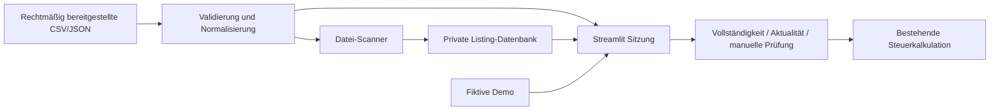

> Historischer Grundlagenstand Auftrag 02. Änderungen aus Auftrag 03: [Bericht](REPORT-03.md), [Speicherung](STORAGE-03.md), [Architektur](ARCHITECTURE-03.md).

# Scanner, privater Zugriff und ERP-Grenze

## Ist-Stand



`scoring.py` und vorhandene Regressionstests bleiben erhalten. `listings.py`
enthält den echten Importvertrag; das alte `Lot`-Modell in `sources.py` bleibt
für die Demo kompatibel. `imports.py` ist die reine Importgrenze, `scanner.py`
Worker/Repository, `assessment.py` die Freigabesperre. Keine direkte HTTP-Anbindung.

SQLite speichert nur Angebotsbeobachtungen und Import-Digests. Keine Lagerplätze,
Bestände, Rechnungen, Buchungen oder Einkaufsausführung. Das separate ERP wird
nicht gelesen, geändert oder kontaktiert. Eine spätere ERP-Übernahme erfolgt
nach expliziter Nutzerentscheidung mit stabiler Quellen-ID und Herkunft.

`workspace` stammt derzeit aus vertrauenswürdiger Server-/CLI-Konfiguration und
ist Teil aller Speicherschlüssel. Das bereitet getrennte Datenräume vor, ist aber
**keine mandantensichere SaaS-Autorisierung**. Vor mehreren Kunden braucht es
serverseitige Identitäts-/Workspace-Zuordnung, Rechteprüfung pro Anfrage, Quoten,
Migrationen und Betriebskonzept. Keine vom Client frei wählbare Tenant-ID zulassen.

## Vorgeschlagene zukünftige API (noch nicht implementiert)

Versioniertes JSON unter `/api/v1`; OIDC/Bearer-Prüfung serverseitig, Workspace
immer aus autorisierter Identität. Kein öffentlicher Endpoint, keine API-Schlüssel
im Browser. HTTPS, Limits 2 MiB/1.000 Lose und Fehler ohne Rohdaten.

| Methode / Pfad | Vertrag |
|---|---|
| `POST /imports` | Body wie JSON-Importvertrag; `Idempotency-Key` erforderlich. 201 mit `import_id`, Zählern und Status; 409 bei Konflikt; 413 zu groß; 422 invalid. Keine Teilimporte. |
| `GET /listings?cursor=...&limit=...` | `{schema_version:1, listings:[Listing], next_cursor:null|string}`; limit maximal 100, Cursor und Workspace serverseitig validiert. |
| `GET /listings/{source}/{source_id}` | Ein `Listing` oder 404; keine Zugriffsinformationen fremder Workspaces. |
| `POST /assessments` | Quellen-ID plus explizite Kosten-/Steuerannahmen und Review; Snapshot-/Annahmen-Version binden. Ergebnis `blocked` mit Gründen oder `scenario` mit Kalkulation/Herkunft. Keine Kaufaktion. |
| `GET /scan-runs/{run_id}` | Status/Zähler/Fehlercodes und letzter erfolgreicher Quellenabruf, keine Secrets. |

Gemeinsame Fehler: `{error:{code,message}, request_id}`; 401 ohne Anmeldung,
403 ohne Recht. Keine HTTP-Implementierung im MVP. Spätere ERP-Übergabe:
versioniertes `opportunity.selected` mit Auswahl-ID, Listing-Snapshot und
Kalkulations-/Annahmenversion; idempotente Verarbeitung im ERP. Kein Webhook
oder Versand in diesem Auftrag. Kein Bid-/Buy-/Inventory-/Accounting-Endpoint.

## Private iPhone-Web-App / PWA-Vorbereitung

Streamlit bindet standardmäßig nur an `127.0.0.1`, Telemetrie ist deaktiviert.
Ein späterer Host braucht eine explizite Bindungs-/Ingresskonfiguration; erst
nach Auth-/Zugriffsabnahme extern erreichbar machen.

Standard ist `SCANNER_ACCESS_MODE=private`: Ohne OIDC-Konfiguration und
Identitäts-Allowlist stoppt die App **vor** Angebot, Upload und Datenbankanzeige.
Nur expliziter `local`-Modus ermöglicht Entwicklung ohne Anmeldung; niemals so
öffentlich hosten. Native Streamlit-OIDC-Anmeldung vermeidet eigenes Frontend.
Allowlist nutzt unveränderliches `iss` + `sub`, nicht eine ungeprüfte E-Mail-Adresse.
Ein angemeldetes beliebiges Konto ist deshalb noch nicht autorisiert.

Für späteres privates Hosting im Secret-Store des Anbieters konfigurieren
(nur Platzhalter, keine echten Zugangsdaten im Repository):

```toml
[auth]
redirect_uri = "https://PRIVATE_HOST/oauth2callback"
cookie_secret = "GENERATE_STRONG_RANDOM_SECRET_OUTSIDE_GIT"
client_id = "CONFIGURE_PROVIDER_CLIENT_ID"
client_secret = "CONFIGURE_PROVIDER_SECRET"
server_metadata_url = "https://OIDC_PROVIDER/.well-known/openid-configuration"

[[scanner.allowed_identities]]
issuer = "https://OIDC_PROVIDER"
subject = "VERIFIED_OWNER_SUBJECT"
```

Anbieter-Discovery, Redirect-URI, Identität und TLS vor Betrieb verifizieren.
Beleg: [Streamlit OIDC-Dokumentation](https://docs.streamlit.io/develop/concepts/connections/authentication).
Es wurde kein Identity-Provider registriert und kein Secret angelegt. OIDC-
Roundtrip ist mangels konfiguriertem Provider noch nicht getestet. Private-
Fehlerzustände und Allowlist sind automatisiert getestet. Vor echter Freigabe
abgemeldet, falsches Konto, korrektes Konto und Abmelden auf echtem iPhone testen.

[pwa/manifest.webmanifest](../pwa/manifest.webmanifest) und Icon liegen als
Vorbereitung bereit. Sie sind **noch nicht in den Streamlit-Seitenkopf eingebunden**:
Der spätere private Host muss Manifest/Icon bereitstellen und den Manifest-Link
am Dokument einfügen; Pfade/Scope bei Unterpfad-Hosting anpassen. Ohne diesen
Hosting-Schritt keine vollständige installierbare PWA behaupten. Ein Safari-
Home-Bildschirm-Web-App-Start ist unabhängig davon möglich, sobald ein erlaubter
privater HTTPS-Host existiert. [Apple-Anleitung](https://support.apple.com/en-eg/guide/iphone/iphea86e5236/ios).

Kein Service Worker, kein Offlinecache privater Daten, kein Push und kein
Hintergrundscan auf dem iPhone. Die scanbare Quelle liegt später auf dem Server;
das iPhone dient zur Bedienung. Kein öffentliches oder privates Deployment im Auftrag.

## Bestandsaufnahme und technische Schulden

Ausgangsbasis `acb3011` (gemergter PR #1): vorhandene 28 Tests bestanden; alle
Quellmodule, Anforderungen, README, CI und Tests gelesen. Finanzlogik erhalten.
Vor diesem Auftrag fehlten Import, nachvollziehbare Herkunft, Duplikatpolitik,
Persistenz, Worker und Zugriffssperre. Diese Grundlagen sind jetzt implementiert.

Weiterhin offen:

* Schriftliche Quellenfreigabe und tatsächlich nutzbarer API-/Feed-Zugang.
* Verifizierter echter Nutzerexport für Abnahmetest; Tests verwenden fiktive Daten.
* Keine erprobte Provider-Authentifizierung oder Safari-PWA-Installation.
* SQLite speichert nur neuesten Snapshot; keine revisionssichere Historie,
  Migrationen, Backup-/Retentionjobs, Worker-Supervision oder Monitoring.
* Keine unabhängige Echtheits-/Marktpreisprüfung. Herkunft sind deklarierte
  Belege; falsche Angaben können nicht automatisch erkannt werden.
* Upload und Parser begrenzen Dateien auf 2 MiB; der zukünftige private Host
  braucht zusätzlich passende Proxy-/Anfragelimits und Nutzerquoten.
* Steuerliche Fälle und Gebühren außerhalb des bestehenden Modells bleiben
  gesperrt; keine Differenzbesteuerung. Geldwerte nutzen weiterhin Float,
  keine centgenaue Rechnungslogik. Keine verdeckten Auktions-Höchstgebote erfinden.
* Dependency-Ranges statt Lockfile; CI prüft jeweils installierte Versionen.
  Demo- und Realmodell bewusst getrennt, später Adapter vereinheitlichen.
* Quellübergreifende Dubletten/Blocklose, Gebotsschritte, Währungskonvertierung und
  Auftrags-/Reservestatus benötigen eine separate fachliche Implementierung.

Nächste Entwicklung: genau eine autorisierte Quelle samt realem Export in den
Vertrag überführen, als read-only Connector mit Fehler-/Limit-/Zeitstempeltests
abnehmen; anschließend privaten Host und Worker-Persistenz freigeben lassen.
